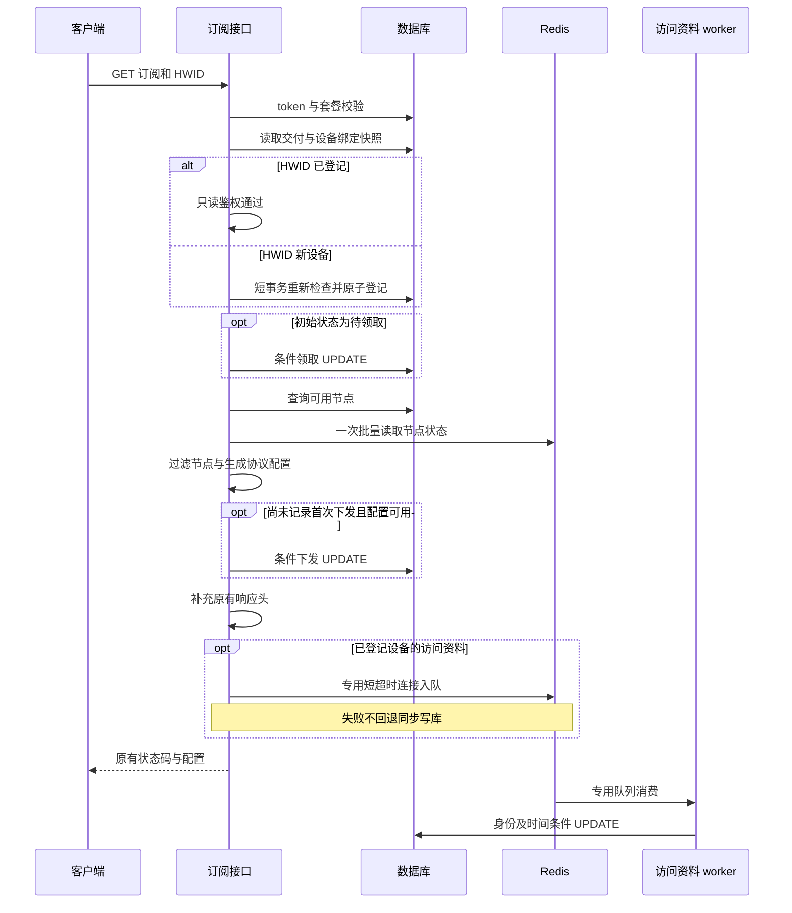

# 订阅下载性能修复详细设计

状态：详细设计已完成源码复核，尚未实现或部署。版本：1.0。日期：2026 年 10 月 25 日。

源码基线：`0235c106e724f26b3cf2441fc9c5fb9ecda24959`，本地 `develop`。本设计供后端开发、测试和发布人员使用，解决订阅请求中不必要的数据库写锁等待、节点状态缓存重复读取，以及缺少请求阶段耗时证据的问题。生产当前运行版本和客户故障根因须用实际运行证据核实。

采用四项改动：重复下载跳过已完成的交付状态写入；已登记 HWID 走数据库只读鉴权并异步更新访问资料；节点状态按请求批量读取；增加不依赖数据库的阶段耗时日志。首次设备登记、首次领取和首次下发记录继续同步完成。数据库引擎迁移另行立项，本设计不增加数据库表或字段。

## 一 问题判断与修复边界

多位客户在不同网络下遇到扫描订阅链接后长时间加载，应优先排查公共服务链路。现有代码存在可复现的性能放大点，但它们尚不能直接证明本次客户故障全部由数据库锁造成。

| 已核实的源码事实 | 设计判断 |
| --- | --- |
| 分销商名称已存入 `subscription_name`；下载时读取名称并生成响应头。当前代码不在下载过程中生成名称 | 保留名称、订单号及相关响应头，不通过删除展示功能解决问题 |
| 成功下载时，即使已经领取和下发，仍发送两条交付表 UPDATE | 条件不命中和 COALESCE 保留原值仍不等于没有写锁请求；应在 PHP 层跳过不需要执行的 SQL |
| 已登记设备也进入 `SqliteImmediateTransaction::write()`，更新 `last_seen_at` 等资料 | 把授权读取与访问资料更新分开；不能把设备数量限制一起异步化 |
| 节点数组序列化反复调用状态访问器，在线节点可产生 9 次缓存读取 | 用同一默认 Cache store 的批量读取为模型提供本次请求快照 |
| Horizon 的 Redis 入队在实际写队列前后执行同步元数据监听器 | 普通 `dispatch()` 加一个短超时连接，不能保证全部入队访问都使用该连接 |

命名功能历史上有过在 GET 中补名称的中间实现，已在 `1e5e7d4` 中移除，当前基线包含此修复。订单号关联查询是按主键读取，早于本次名称展示功能存在。本次不回退名称功能，也不在订阅 GET 中增加历史名称回填。

本次保留 token、用户 UUID、订阅 URL、设备上限、套餐权限、流量限制、到期校验、协议生成、订单状态和结算规则。关闭交付与撤销订阅不是同一规则；不能在性能优化中暗中改变授权语义。

不纳入本次：数据库引擎迁移、完整订阅内容缓存、Redis 授权缓存、全局锁超时调整、客户端重试策略、节点连接诊断平台改造、无证据的索引新增，以及相邻业务重构。

## 二 已有测量与证据适用范围

以下为 2026 年 10 月 25 日已完成的本地合成探针结果，不是生产压测。请求探针使用当前应用代码、SQLite 内存库和 array cache；每组 20 次，绕过公网和实际 Redis 网络。数据均为合成数据。

| 请求场景 | 中位数 | p95 | SQL 总数 | 写 SQL 数 | 节点状态读取数 |
| --- | ---: | ---: | ---: | ---: | ---: |
| 1 节点，当前命名，已登记 HWID | 11.782 ms | 14.007 ms | 10 | 3 | 9 |
| 1 节点，旧命名，已登记 HWID | 12.272 ms | 15.353 ms | 10 | 3 | 9 |
| 100 节点，当前命名，已登记 HWID | 91.857 ms | 106.909 ms | 10 | 3 | 900 |
| 100 节点，旧命名，已登记 HWID | 111.057 ms | 141.159 ms | 10 | 3 | 900 |
| 100 节点，HWID 关闭 | 86.870 ms | 114.919 ms | 7 | 2 | 900 |

新旧命名的 SQL 和缓存调用数量一致，对应订阅正文 hash 一致。样本只支持“未发现命名增加热路径查询量”，不用于判断哪个命名更快，也不能把这些毫秒数承诺为生产响应时间。

另一个 SQLite 文件库 WAL 探针由独立进程持有约 1.5 秒写锁。普通 SELECT 约 2.4 ms 返回；`BEGIN IMMEDIATE`、零行 UPDATE、保留原值的 COALESCE UPDATE 均等待约 1.4 秒。它证明即使最终没有业务字段变化，发送写操作也可能等待其他业务释放写锁；不证明客户现场恰好发生了相同持锁事件。

临时探针证据保存在本机 `C:/Temp/xboard-subscription-perf-20261025`，不是仓库测试资产。正式开发须将关键行为和竞争场景转为可重复的仓库测试。当前临时功能探针 1 项、250 个断言通过；命名相关定向测试 2 项、185 个断言通过，这些结果不代表候选实现已经通过测试。

## 三 请求流程与组件职责

### 3.1 目标请求流程



设备资料事件以 HWID 授权成功为产生条件，在控制器 `finally` 中尝试发布。因此协议生成或后续响应头处理失败时，仍可记录此次已经通过设备授权的访问，接近原有更新发生在配置生成之前的行为。发布失败不得覆盖原始异常或响应。新设备插入已记录本次资料，不再为同一次访问发布冗余事件。

### 3.2 拟修改与新增文件

以下为未来开发范围，本次仅新增本设计文档。

| 文件或组件 | 责任 |
| --- | --- |
| `app/Http/Controllers/V1/Client/ClientController.php` | 交付状态 SQL 前置判断、条件下发、阶段计时、finally 发布访问资料 |
| `app/Services/DistributorHwidService.php` | 已登记设备只读分支、新设备原子登记、返回内部观测载荷 |
| 新增 `app/Jobs/UpdateDistributorHwidObservation.php` | 按设备身份和观测时间条件更新现有设备资料 |
| 新增 `app/Exceptions/HwidObservationPersistenceException.php` | 固定安全错误分类，阻止原始 SQL 异常经默认日志通道泄漏资料 |
| 新增 `app/Services/DistributorHwidObservationPublisher.php` | 显式选择生产连接，捕获入队异常，不触发同步写库 |
| 新增 `app/Queue/HwidObservationRedisQueue.php` 与对应 connector | 复用框架标准 Redis queue，仅补 Horizon 管理进程需要的 `readyNow()` |
| 新增 `app/Providers/SubscriptionServiceProvider.php`，注册于 `config/app.php` | 注册专用 queue driver；不替换通用 redis driver |
| `app/Models/Server.php`、`app/Services/ServerService.php` | 批量预取节点状态、实例私有快照、保持所有返回字段 |
| 新增 `app/Http/Middleware/SubscriptionRequestTiming.php`、`app/Support/SubscriptionTiming.php` | 请求级计时及安全日志；在 `app/Http/Kernel.php` 注册最外层起点 |
| `app/Http/Middleware/Client.php` | token 查找阶段计时，保持校验结果 |
| 新增 `config/subscription.php`；修改 `config/database.php`、`config/queue.php`、`config/horizon.php`、`.env.example` | 功能开关、独立 Redis 生产连接、专用队列和消费者配置 |
| 新增 `app/Console/Commands/InspectHwidObservationQueue.php`，接入 `app/Console/Kernel.php` | 只读报告专用队列数量与等待时间，提供发布排空检查 |
| 新增 `app/Console/Commands/PruneHwidObservationFailures.php` | 仅清理本队列超过 7 天的失败任务，限批执行并支持 dry-run |
| `.docker/entrypoint.sh`、`.github/scripts/activate-xboard-green-roles.sh`、`.github/scripts/v2-low-memory-common.sh` 及对应发布检查 | 显式计入消费者资源，核对配置传递，补齐专用队列检查及退出等待 |
| 分销功能测试、节点状态单元测试、新增隔离集成测试 | 状态竞争、资料乱序、Redis 故障、队列生命周期及实际锁竞争验收 |

不修改 `SqliteImmediateTransaction` 的通用重试、提交和回滚实现，不修改诊断系统现有未提交文件，不修改后台构建产物。若实现中发现必须扩大范围，应先列出具体原因并修订设计。

## 四 交付状态更新设计

### 4.1 状态与业务不变量

交付状态与 `config_issued_at` 分别表达领取和后端下发记录。首次下发标记不等于手机完整接收、解析成功或节点连接成功。

| 初始交付快照 | 生成配置之前 | 可用配置生成之后 | 稳态交付表写 SQL 次数 |
| --- | --- | --- | ---: |
| 无分销交付 | 不执行 | 不执行 | 0 |
| PENDING，未下发 | 尝试 PENDING→CLAIMED | 尝试 CLAIMED 且未下发→首次下发 | 2 |
| CLAIMED，未下发 | 不执行 | 尝试首次下发 | 1 |
| CLAIMED，已下发 | 不执行 | 不执行 | 0 |
| CLOSED | 不执行 | 不执行 | 0 |

表中的“可用”沿用当前 `isUsableSubscriptionResponse()`，不借本次重写配置有效性判定。空响应或生成异常不写下发标记；如果此前已经成功领取，仍保留 CLAIMED。历史 CLAIMED 且未下发是合法恢复状态。

### 4.2 PHP 前置判断与 SQL 最终条件

在获得 HWID 授权结果时保存 `initialStatus`、`initialConfigIssuedAt`；不为判断增加刷新查询。PHP 判断只用来避免明显不需要的 SQL，最终正确性依赖数据库条件更新。

```text
if initialStatus == PENDING:
    UPDATE delivery
       SET status = CLAIMED,
           claimed_at = COALESCE(claimed_at, now),
           claim_ip = request_ip, claim_ua = request_ua, updated_at = now
     WHERE id = delivery_id AND status = PENDING

response = 原有配置生成逻辑

if initialStatus in [PENDING, CLAIMED]
   and initialConfigIssuedAt is null
   and isUsableSubscriptionResponse(response):
    UPDATE delivery
       SET config_issued_at = now, updated_at = now
     WHERE id = delivery_id AND status = CLAIMED
       AND config_issued_at IS NULL
```

伪代码中的 `status` 对应实际 `delivery_status`，时间和字段截断沿用当前实现。不能只接受内存中的 CLAIMED，因为 query builder 的领取 UPDATE 不会更新原模型。也不能要求领取 UPDATE 影响 1 行才允许尝试下发：并发另一请求可能先领取，本请求先生成可用配置。

UPDATE 影响 0 行是允许的竞争结果，不直接转换为 403、409 或重试覆盖。两个请求同时读到旧快照时，仍可能各自发送条件 UPDATE；“零交付写入”承诺针对已经完成下发的稳定快照，不包括竞争中的首次请求。

### 4.3 并发和兼容性

- 两个请求首次领取时，只保留一个成功领取者的 IP、UA 和首次时间；首次下发由第一个成功持久化下发标记的请求确定。
- 关闭先赢时，PENDING 已转为 CLOSED，领取和下发 SQL 都不能复活它。当前普通订阅 GET 不因 CLOSED 自动拒绝配置，本次保留该 HTTP 行为。
- 领取先赢时，原有“仅 PENDING 可关闭”规则继续生效。不得将领取移到生成之后或把两阶段包入长事务。
- 首次下发记录保持在生成成功之后、返回响应之前同步完成。`connected_at` 依赖已有下发标记后收到正流量上报，因此不将此标记交给队列。
- 续费沿用原交付，不重置首次记录；结算字段不参与本次 UPDATE。禁止对旧模型调用整对象 `save()` 覆盖并发业务更新。
- 已完成下发的重复 GET 不再推进交付表 `updated_at`。该字段不能继续被当作最近订阅访问时间；设备访问资料和请求日志各自表达其观测范围。
- 当前业务没有常规路径把 CLAIMED/CLOSED 重置成 PENDING 或清空首次下发时间。未来若引入重置功能，必须重新审查前置跳过逻辑。

## 五 HWID 授权与访问资料分离

### 5.1 返回契约

保持 `authorizeSubscription(User, Request)` 的原有 `delivery`、`allowed`、`headers` 返回项。新增可空内部项 `observation`，只在已登记设备授权通过时赋值，不进入 HTTP 响应或普通日志。

观测载荷为标量：`device_id`、`distributor_order_id`、`hwid`、服务端 `observed_at`、经过现有长度限制的设备 OS、OS 版本、型号、UA、IP。不得序列化 User、Request 或 Eloquent 模型，不携带 token、UUID、订阅正文或订单财务数据。

### 5.2 已登记设备只读分支

使用交付表与目标 HWID 设备的 LEFT JOIN 获得同一 SQL 快照：按 `subscriber_user_id` 定位交付，以交付 ID 和经过验证的 HWID 关联设备。选择 `delivery.*` 和设备 ID 别名；提取设备 ID 后从返回模型属性中移除别名。无效 HWID 不直接作为任意长度查询条件，先按现有正则校验，再以不匹配设备的条件读取交付。

决策顺序保持：无分销交付或 HWID 关闭时允许；开启但 HWID 无效时返回现有 404 和 not-supported 响应头；开启且设备存在时允许，生成 observation；开启且设备不存在时进入登记事务。已有 `subscriber_user_id` 唯一索引及 `(distributor_order_id, hwid)` 唯一约束继续使用，不新建授权缓存。

已登记设备不执行 `BEGIN IMMEDIATE`、设备 UPDATE 或数量 count。设备上限降低后仍允许现有绑定访问，新增设备受新上限约束，沿用当前规则。

### 5.3 新设备事务

继续使用现有短写事务，事务内重新读取交付、开关、设备和登记数量。每次可重试执行都重新查询模型，不能复用上一次已修改的 Eloquent 实例。

1. 交付在首次读取后消失：拒绝，返回 404，不视为普通非分销用户放行。这是针对已观察到交付后发生删除的明确保护。
2. 交付存在但此时关闭 HWID：按当前开关允许，不插入设备。
3. 同 HWID 已被并发请求登记：允许，返回已有设备观测，交给异步资料路径。
4. 当前数量已达到上限：返回现有 404、`x-hwid-max-devices-reached` 和 `x-hwid-limit`。
5. 仍有容量：插入一条设备记录，包含首次及最近访问时间和本次资料，然后提交。

唯一键作为重复绑定最后一道约束；同订单不同 HWID 的限额检查必须在同一交付锁保护下完成。新设备同步失败不得改成先放行再补登记。此路径仍可能等待 SQLite 写锁。

### 5.4 删除和开关竞争

管理员删除设备表示释放名额，不是永久封禁该 HWID。删除完成后的新请求必须重新读取数据库；如果仍有名额，同 HWID 可以按当前规则重新登记。已经读取到有效绑定的在途请求可能继续返回配置，本次不承诺取消所有在途请求。

队列任务只更新原设备 ID，不执行 upsert 或 create。设备被删除后，旧任务影响 0 行；同 HWID 重新登记得到新 ID，旧任务不得更新新记录。开关并发修改按读快照或登记事务中的最终检查决定，不将 Redis 资料视为权限依据。

### 5.5 异步条件更新

worker 使用一条 UPDATE 原子更新资料，不先查后写：

```text
UPDATE v2_distributor_hwid_device
   SET last_seen_at = observed_at,
       本次非空资料字段 = 对应截断值,
       updated_at = observed_at
 WHERE id = device_id
   AND distributor_order_id = delivery_id
   AND hwid = expected_hwid
   AND (last_seen_at IS NULL OR last_seen_at < observed_at)
```

只更新本次提供的非空资料，不用缺失请求头清空旧值。时间采用授权时的服务端秒级时间，不采用队列执行时间。过期或重复事件不能覆盖较新的整组资料；同一秒的事件以第一个被接受的观测为准，不增加毫秒字段。

`last_seen_at` 从请求内同步更新变为最终更新，队列故障时允许滞后或丢失。它表示服务端已持久化的设备访问观测，不是实时在线状态、授权租约或计费依据。首版不做额外采样或五分钟节流；异步主要移走响应路径等待，并不保证减少全库最终写入总量。

## 六 专用队列与故障处理

### 6.1 队列实现选择

本功能采用框架标准 `Illuminate\Queue\RedisQueue`，使用独立 driver `hwid-observation-redis`。增加薄子类只补 `readyNow($queue)`，转调当前框架的 `pendingSize($queue)`，供 Horizon 的等待时间计算使用。不继承 Horizon RedisQueue，不复制其 payload 格式或私有监听器，不修改 vendor。

这样生产请求不触发 Horizon 的 `JobPending`、`JobPushed` 同步元数据写入。消费端也使用同一专用 driver，标准 Laravel 的任务序列化、保留、释放和重试行为继续由框架处理。

Horizon 现有 role 增加固定 1 进程的独立 supervisor，管理该专用队列；不新增容器角色，不加入 `business` 的 default/order_handle 队列。Horizon 不会提供该队列正常任务的完整 pending/reserved/completed 明细；全局失败监听仍可能记录失败任务，不能把该看板当作完整执行账本。其等待时间估算依赖历史运行指标，本队列不能依赖该估算告警，使用本节只读状态命令和结构化 worker 日志观测。

### 6.2 配置契约

| 配置 | 初始设计值与用途 |
| --- | --- |
| `SUBSCRIPTION_HWID_ASYNC_METADATA` | 默认 false；false 使用原 HWID 授权及同步资料路径，true 使用第五节路径 |
| `SUBSCRIPTION_HWID_OBSERVATION_WORKER_ENABLED` | 默认 false；true 才注册专用 supervisor，独立于生产开关，以支持先启动消费者和回滚排空 |
| 专用 Redis 连接 `hwid_observation_publish` | 复用现有 Redis 地址、凭据解析、DB 和 prefix，独立连接配置，`persistent=false` |
| 生产连接 connect/read timeout | 初始各 0.10 秒；PhpRedis 对应 `timeout`/`read_timeout`，并设置 `max_retries=0`、`retry_interval=0`；Predis 对应 `timeout`/`read_write_timeout`，不启用重试适配 |
| queue connection `hwid_observation_publish` | driver 为专用 driver，Redis 连接为同名生产连接，queue 为 `hwid_observation` |
| queue connection `hwid_observation_worker` | 同 driver、同 queue、同 Redis DB/prefix；Redis 连接使用正常消费者连接，避免用生产端短读超时限制消费 |
| 专用 Horizon supervisor | `hwid-observation`，connection 为 worker connection，queue 仅 `hwid_observation`，balance 为 simple，min/maxProcesses 均为 1 |
| Job 与 supervisor timeout | 45 秒；覆盖当前 30 秒 SQLite busy timeout 加执行余量；目标环境若不同必须重新核定 |
| `retry_after` | 两个 queue connection 均为 90 秒，严格大于 worker timeout |
| 尝试次数与 backoff | 最多 3 次，失败重试间隔 5 秒、30 秒；不无限重试 |
| block_for | null；使用普通轮询，不给生产连接配置阻塞读 |
| worker 生命周期 | 复用现有内存和 maxJobs/maxTime 约束；角色优雅退出至少等待 60 秒，覆盖 45 秒 worker timeout |

生产者通过 `Queue::connection('hwid_observation_publish')->push(...)` 显式入队，不能依赖默认 `QUEUE_CONNECTION`，因为其默认值为 sync。禁止 `dispatchSync()`、数据库 queue、失败后同步补写，也禁止用 `dispatchAfterResponse()` 代替真实 worker；当前框架的后者仍在 Web 进程结束阶段执行同步分发。

生产者和消费者必须共享同一 Redis 实例、数据库、键前缀与 queue 名称，启动及隔离测试核对这四项。发布检查拒绝“生产开关开启而消费者未启用”的配置。不能临时修改全局 Redis/Horizon 配置后恢复，这在 Octane 并发请求下会影响其他业务。

2026-10-27 配置校验修订：消费者开关为 true 时，必须在 Horizon 实际采用的计划中存在 `hwid-observation`，不能只校验已经存在的同名项。按框架顺序合并 `defaults`，采用第一个匹配环境（包含通配项）；核对 `horizon.env` 或 `app.env` 对应的子进程配置，并在主进程使用 `--environment` 时同时核对其选择，防止只放行主进程而子进程启动失败。消费者关闭时不要求创建该 supervisor，保留双开关关闭的阶段 A。

消费者开启时，资源计算预留一个额外 PHP worker，并检查容器实际内存预算；显式配置的其他进程上限不被静默改写。minimal profile 不能假定原预算容纳第四个队列 worker，资源不足则保持新消费者和生产开关关闭。候选验收记录空闲与峰值 RSS，资源检查通过后才启用消费者。

连接超时是每次 I/O 的限制，不是发布操作的数学总 deadline。连接、认证、SELECT、写入、解析可能累计；初始故障注入验收目标为单次发布在 1 秒内结束，不因资料故障失败响应。必须实测连接拒绝、黑洞、已连接后断开以及 Horizon 元数据 Redis 故障；未通过则不开启功能，不能仅凭两个 0.10 秒参数声称总耗时小于 0.20 秒。

### 6.3 故障语义

| 故障 | 行为 |
| --- | --- |
| Redis 连接或入队失败 | 记录安全错误分类，保留原订阅结果；不同步写设备表 |
| 已写队列但确认丢失 | 本次发布结果记 unknown，不在请求中重发；如果任务实际存在，条件 UPDATE 保证幂等 |
| worker 暂停 | 队列积压、资料延迟；订阅授权继续查数据库 |
| worker 写库 busy 或临时错误 | 由任务重试机制处理，不影响已经完成的订阅响应 |
| 任务重复、乱序或旧设备被删除 | UPDATE 影响 0 行，视为正常 no-op，不重建绑定 |
| 超过重试次数 | 进入现有失败任务处理；记录分类，不自动无限重放 |
| 配置生成异常且发布也失败 | 保留原始生成异常，发布只产生独立观测结果 |

队列不是持久审计渠道。告警初始阈值为最老 ready 任务等待超过 60 秒持续 5 分钟，或 ready/reserved/delayed 总量超过 10,000；这些是保守运维阈值，不是容量结论。达到阈值应检查消费者与数据库持锁，必要时关闭新生产，不通过提高进程数争抢 SQLite 写锁。不要自动清空队列或删除业务 failed_jobs。

只读命令 `php artisan subscription:hwid-queue-status` 使用 worker connection 的 `statusSnapshot()`，在一次 `MULTI/EXEC` 中读取 ready/reserved/delayed 三个计数及队首载荷，只从 JSON 提取 `createdAt`，输出数量和 `oldest_ready_age_seconds`。这避免任务迁移时多次独立读取产生假零。空队列年龄为 null；事务异常尝试 `DISCARD` 并保留原错误，返回无效快照或无法解码时失败，不伪装为 0，不反序列化或输出 Job 载荷。`--require-empty` 在任一数量非零时返回非零退出码；排空时先停生产，保留连续三次间隔 2 秒均为零才通过的策略。

现有 scheduler 每分钟执行一次状态采样并输出 `subscription.hwid_queue` 日志；连续五条超阈值日志构成上述持续告警条件，首版不新建通知系统。worker 另记录任务等待时间和处理结果；发布排空不依赖日志采样。failed_jobs 按本队列及两种连接名另行核对数量和重试来源，不对普通业务任务做全表重放。

资料包含设备信息与 IP，只保存在已有受限 Redis/数据库及失败任务存储中，不写入普通日志、Horizon tags 或告警正文。Job 的数据库调用必须捕获异常，并转换为仅含 `db_busy`、`db_unavailable`、`db_write_failed` 等固定分类的 `HwidObservationPersistenceException` 后交给队列重试；不附原始 message、SQL、bindings、previous 异常链或带资料的 context。不能只给自有日志脱敏，因为框架默认 Handler、worker stderr 和 Horizon 失败异常文本也会报告抛出的异常。分类使用数据库错误码等结构化字段，不把原始异常文本存到新异常中。

失败任务回放仅由包含该 Job 类的版本执行。当前未核实通用 failed_jobs 存在自动清理，故为本队列明确保留 7 天：新增 `subscription:hwid-failures-prune`，默认 dry-run，每日由 scheduler 显式带 `--execute` 执行；只选择 queue 为 `hwid_observation` 且 connection 为本设计两种连接名、failed_at 早于 7 天的记录，每批最多 100 条、每次最多 10 批，输出数量不输出 payload。Horizon 的失败记录沿用当前 7 天 trim。其他队列的失败任务和保留规则不变；此清理不触碰 ready/reserved/delayed。测试必须证明筛选隔离及时间边界。首版不提供设备资料的永久审计承诺。

## 七 节点状态批量预取

### 7.1 键生成与注入

在 `ServerService::getAvailableServers()` 查询到节点后、序列化之前，为每个节点构造现有三个完整缓存键：LAST_CHECK_AT、LAST_PUSH_AT、ONLINE_USER。类型继续使用 `strtoupper(type)`，状态 ID 使用 `parent_id ?: id`，通过原 `CacheKey::get()` 生成。

按完整键去重，不能仅按父节点 ID 去重。非空节点列表调用一次默认 `Cache::many($keys)`；空列表不调用。使用同一默认 store，保留其 prefix、反序列化和逐键命中/未命中语义，不直接调用原始 Redis MGET。开始读取事件由 RetrievingKey 变为 RetrievingManyKeys，事件次数按去重键减少；不承诺缓存事件类型和次数不变。当前仓库未发现依赖这些逐次事件的业务逻辑，部署插件仍需兼容性核对。

为每个 Server 模型注入只含其三个完整键的私有数组。三个基础访问器按当前完整键执行 `array_key_exists`：快照包含键时返回快照值，包括 null；没有该键时才走原 `Cache::get()`。快照重新注入时整体替换，不积累旧键。

### 7.2 一致性与范围

- null 是已读取但不存在，不能用 `isset` 导致每次 miss 再回源。
- 原值类型不额外强制转换，`online` 仍执行原有 `?? 0`；`is_online`、`available_status`、`cache_key` 使用原公式。
- 模型 id、type 或 parent_id 改变后会生成新键，自动不匹配旧快照并回到现有读取路径，不能读到其他节点值。
- 快照不放入 `$attributes`、relations、静态成员或容器单例，不出现在 JSON；当前调用创建模型并立即转数组，不跨请求复用。
- `getAllServers()` 等未注入快照的路径维持原行为。动态端口、用户密码、倍率、字段顺序及节点过滤保持原逻辑。
- `client.subscribe.servers` hook 收到的仍是完整数组；Client App 配置与用户节点列表的共享调用者保持原字段与 ETag 含义。
- 缓存调用异常维持现有错误传播，不吞错后伪造在线状态，也不退回几百次单键查询。正常 miss 与缓存服务失败必须区分。

100 个独立在线节点的状态阶段目标是：1 次 many、最多 300 个不同键、随后 0 次状态单键 GET。当前单机 Redis 可实现为一次 MGET；不同驱动或集群适配不保证一次网络往返。模板缓存等其他阶段单独统计，不能宣称整个订阅请求只访问 Redis 一次。

## 八 请求计时与诊断日志

### 8.1 时间范围

最外层全局中间件在 request attributes 保存 `hrtime(true)` 起点和请求级 collector，在 finally 结束。路由解析后仅对 `client.subscribe`、`client.subscribe.legacy` 输出事件。全局插件初始化因此计入 `app_duration_ms`；在路由解析之前就被拒绝的请求不强行归入订阅事件。

`app_duration_ms` 不包括 CDN、DNS、TCP/TLS、进入 PHP worker 前的排队、实际网络发送及客户端解析。协议正文长度是生成的 body 字节数，不是手机收到的字节数。需要判断网络与源站责任时，关联入口日志和真实客户端测试。

### 8.2 阶段和字段

固定阶段包括 `token_lookup`、`hwid_authorize`、`delivery_claim`、`server_lookup_transform`、`server_status_cache`、`protocol_generate`、`delivery_issue`、`response_headers`、`observation_publish`。嵌套阶段明确标为父子关系，不能把节点总阶段与其中缓存阶段简单相加。未单独计时的全局中间件和 hook 仍包含在应用总耗时中。

记录服务端随机 request ID、固定路由名、结果分类、已知响应状态、应用总耗时、阶段耗时、节点数、缓存唯一键数、交付写 SQL 尝试数、HWID 分支和发布结果。异常尚未转为 HTTP Response 时状态写 null，记录安全异常类别，不自行把所有异常归为 500。

完整 HWID 阶段包含读取、可能的获取写锁和事务执行。它不能直接命名为精确锁等待。`BEGIN IMMEDIATE` 由 PDO 直接执行，普通 `DB::listen` 看不到该等待；首版不为精确拆分而修改通用事务 helper。精确归因由隔离持锁测试及必要的专项诊断完成。

生产计时不在每个请求动态注册 DB/Redis listener。SQL 总数、实际 Redis 命令数由隔离测试采集；生产仅报告能直接确认的阶段及操作尝试数，不能把局部计数称为全请求 SQL 总数。collector 不跨请求保存，不依赖 Octane 单例中的当前用户或请求。

### 8.3 日志安全与采样

使用现有 daily 文件日志通道，结构化事件名为 `subscription.request`、`subscription.hwid_observation`。日志失败不能替换订阅结果。默认成功请求采样 1%，应用耗时达到 1,000 ms 的慢请求及异常请求保留；通过配置可关闭本功能日志。沿用现有日志轮转，不写数据库或依赖 Redis 输出计时结果。

禁止记录完整 URL/query、token、UUID、HWID、IP、原始 UA、请求正文、订阅正文、SQL bindings、未筛选的异常 message。采用固定错误分类和异常类名；request ID 由服务端生成，不直接接受任意外部字符串。需要与入口关联时只补充经过限制和验证的关联 ID，并单独审查入口日志是否泄漏订阅路径。

## 九 接口兼容与故障矩阵

| 场景 | 必须保持或明确接受的行为 |
| --- | --- |
| HEAD、prefetch | 仍为 405 / 425，不能绑定设备、领取或写下发记录 |
| token 无效、套餐不可用 | 保留现有鉴权异常或 403，不生成配置 |
| HWID 缺失或非法 | 仍返回 404 及原 not-supported 头，不记录授权成功观测 |
| 设备数量超限 | 仍返回 404 及原限额头，不超卖设备名额 |
| 非分销订阅、HWID 关闭 | 不因新增队列成为强依赖 |
| 新设备第一次导入 | 同步登记成功后才允许返回；首次领取和下发仍同步 |
| 已登记设备重复更新 | 数据库读取决定权限，设备访问资料允许最终更新 |
| 名称、订单号与下载文件名 | profile-title、content-disposition、x-order-no 兼容，GET 不生成或回填名称 |
| 空响应或协议异常 | 保留已成功领取；本次不新增下发标记，原为空则保持为空，原有首次下发时间不清空；观测事件失败不掩盖原错误 |
| 关闭交付 | 不复活 CLOSED；不新增关闭即撤销订阅规则 |
| 节点状态或模板 Redis 故障 | 不宣称所有 Redis 故障都能正常下载；资料队列故障隔离仅限该新增旁路 |
| 客户端重复请求或重试 | 条件状态更新和任务幂等保护，首次竞争仍可出现零行写 SQL |

## 十 开发测试与验收

### 10.1 功能和并发测试矩阵

先补测试契约，再按任务分步实现。以下是必须覆盖的测试组；可复用已有测试文件，不要求每行单独创建文件。

| 编号 | 验证场景 | 硬性断言 |
| --- | --- | --- |
| S01 | PENDING 首次成功、CLAIMED 未下发恢复、已下发重复下载 | 交付写 SQL 分别为 2、1、0，时间与状态正确；不能只断言影响行数 |
| S02 | 两进程同一旧快照领取与下发 | 首次信息不覆盖，无双领或状态回退；未赢领取的请求可赢下发 |
| S03 | 一个请求空配置先领取，另一个成功下发 | CLAIMED 可恢复，下发仅记录一次 |
| S04 | 关闭先赢和领取先赢 | 不复活 CLOSED，HTTP 行为符合当前契约 |
| S05 | HEAD、prefetch、鉴权失败、空配置、协议异常 | 无越权绑定/下发；保留必要的领取语义；已下发订阅后续失败不清空首次记录 |
| S06 | 续费、结算并发、名称新旧格式 | 不覆盖财务字段，不重置首次时间，响应头兼容 |
| H01 | 已绑定设备重复请求 | 不调用写事务、不执行设备 UPDATE/count，生成正确标量事件 |
| H02 | 同 HWID 并发新绑定、不同 HWID 抢最后名额 | 唯一约束有效，登记数不超过限制 |
| H03 | 降低上限、开关变化、交付在登记前消失 | 现有设备规则不变，事务重检不错误放行消失交付 |
| H04 | 删除设备、同 HWID 重绑、旧任务再执行 | 旧 ID 任务不复活或污染新设备 |
| H05 | 事件乱序、重复、同秒、缺少资料头 | 时间不倒退、旧资料不覆盖新资料、缺失值不清空 |
| Q01 | 默认 queue=sync，但功能开启 | 显式生产连接进入真实 Redis，Web 请求不运行 Job handle |
| Q02 | 普通 queue 与 Horizon 集成 | readyNow 可用、固定消费者能处理/重试任务、没有生产端 Horizon 元数据 I/O |
| Q03 | Redis 拒绝/黑洞/断连、元数据 Redis 故障 | 发布达到有界故障目标，原订阅结果不变，无同步补写 |
| Q04 | worker 崩溃、保留任务回收、重试耗尽、7 天失败清理 | retry_after 大于 timeout，重复执行安全，回放与清理仅限本队列 |
| Q05 | 新旧角色切换与回滚、minimal profile、生产/消费开关组合 | 旧 worker 不消费专用队列，三集合检查和失败回放可控，资源及退出时间门禁有效 |
| C01 | null、0、字符串 0、false、临界在线时间 | 返回字段、状态公式和原实现一致，无 miss 回源风暴 |
| C02 | 共享父节点、不同协议、空列表、模型身份改变 | 完整键去重正确，旧身份快照不会用于新身份 |
| C03 | 三个调用者、hook、ETag、动态端口与用户密码 | 结构兼容；随机端口验证范围和关系，不断言随机值完全相同 |
| C04 | 连续请求修改底层状态、Octane 多用户请求 | 无跨请求、跨用户、跨节点快照污染 |
| O01 | 成功、异常、早期拒绝、日志输出异常 | 计时范围明确，不能因观测失败改变订阅结果 |
| O02 | 敏感值夹具、DB 异常、多个连续请求 | 自有日志、默认 Handler、worker stderr、Horizon 异常文本无敏感字段；collector 和 listener 不累积 |

并发测试使用独立数据库连接或独立进程，并设置同步屏障让竞争真正重叠；串行调用两次接口不算并发验证。SQLite 使用独立文件库和 WAL，禁止针对生产数据库制造持锁。

### 10.2 性能测试方法

同一隔离环境比较基准与候选，使用实际 HTTP/Octane、Redis store、SQLite 文件库、相同数据规模和 worker 数。覆盖 1/100 节点、HWID 开/关、首次/重复、新旧命名，以及真实业务代表性的流量写入与订单写入负载。

必须分四组：新订阅加新 HWID，初始为 PENDING 且未下发；已下发订阅新增 HWID，只发生设备首次登记；CLAIMED 且未下发的恢复请求；已登记且已下发的重复请求。各组独立报告写操作数、样本和延迟，不能把旧订阅换设备当作首次领取及下发。

首次组每个样本使用新的独立夹具。预热后交替测试至少三轮，关键场景每轮至少 200 个有效请求；报告 p99 时至少收集 1,000 个有效样本。记录成功率、吞吐、p50/p95、样本数、目标 SQL 次数、Redis 命令数、队列等待、数据库文件与 WAL 变化。

硬性通过条件：

1. 已领取且已下发、HWID 已登记的重复 GET，功能开启后主请求交付 UPDATE=0、设备 UPDATE=0、HWID 写事务=0。worker 的更新单独统计。
2. 100 个独立在线节点的状态读取为 1 次 many；当前单机 Redis 实际为 1 次 MGET、最多 300 key，之后无状态单键 GET。
3. 另一个连接持有 1.5 秒写锁时，上述重复请求不因本次三处原有写操作等待锁；不在含其他写 hook 的环境承诺整个请求绝不写库。
4. 新设备仍严格执行同步设备上限与首次状态记录，竞争下数据一致。不能通过跳过校验换取低延迟。
5. Redis 资料发布的故障测试中，单次发布在 1 秒内结束，订阅结果不因该故障改变；恢复后消费者能处理既有任务。
6. 无内容、头部、ETag、权限、状态或敏感日志回归；隔离环境持续负载下队列能追上生产速率。

初始性能目标为代表性混合负载下重复下载 p95 明显改善、无竞争场景 p95 不超过基准 10%；实施前锁定环境和基线，若基准波动超过 10% 则先稳定测试。绝对线上 SLA 以实测制定，不使用内存探针的 11–100 ms 代替。

首次导入单独报告 p95 和超时率。若仍被其他长写事务阻塞，应根据阶段日志继续定位持锁业务；“重复路径零写”通过并不等于首次导入事故已解决。

### 10.3 项目检查与真实客户端验收

本次文档交付只进行内容、链接和格式检查。实施后先运行相关 PHPUnit 与 JavaScript 定向测试；合入或发布前完成仓库要求的完整 PHPUnit、JavaScript、PHPStan、Composer audit、部署脚本语法、workflow 校验和 `git diff --check`，空检查列表不算通过。

真实验收使用专用 QA 订单，覆盖至少两种不同网络、用户实际客户端、首次扫码及后续更新；记录实际版本、时间、是否多次重试、后台阶段耗时和首次字节/完整下载时间。访问客户真实订阅可能绑定设备或改变交付状态，不能把它当作无副作用健康探测。

## 十一 开发顺序与交付物

| 顺序 | 开发任务 | 完成证据 |
| --- | --- | --- |
| D1 | 固化状态/协议契约和隔离测量夹具；增加阶段计时 | S/O 组基本通过，基准报告有样本和环境信息 |
| D2 | 交付状态前置判断与条件首次下发 | S01–S06，真实并发验证，重复请求交付 SQL 为 0 |
| D3 | 节点状态批量读取与私有快照 | C01–C04，真实 Redis 命令计数与三个调用者一致性 |
| D4 | 专用 queue driver、生产者、Job、消费者配置，默认关闭 | Q01–Q05，H04/H05，故障和切换演练 |
| D5 | 接入 HWID 只读分支及最终发布点 | H01–H03，完整首次/重复/混合负载验收 |
| D6 | 回归、发布准备和实际客户端复核 | 必需 CI、候选环境、客户端和回滚记录 |

D2 与 D3 可独立形成可审查提交；D4 先于 D5 开启。所有开发在主 checkout 的 develop 上完成，保护现有未提交改动。设计不要求创建任务分支或并发写 worktree。

开发交付包含代码、测试、基准与候选对比报告、配置说明、发布及回滚记录。每份性能报告明确区分首次导入、重复下载和后台资料队列，不把一次健康检查作为用户问题已解决的证据。

## 十二 发布与回滚

### 12.1 发布准备

1. 重新核对 develop/main、未提交改动、实际生产 Caddy reverse_proxy 与对应运行容器。不能仅根据 Compose 标签或保留容器判断当前 Web 版本。
2. develop 通过 PR 合入 main；生产操作仅允许 exact main SHA 工作流。SHA、镜像 revision 与不可变 digest 一致。
3. 按现有流程完成 preflight、隔离数据库克隆演练、认证 smoke、配置与角色核对；本设计没有新增 schema migration，已有待迁移项仍须符合批准清单。
4. 演练专用 queue 的生产/消费连接实例、DB、prefix、queue 一致，Horizon supervisor 进程数为 1，额外 worker 资源预算、故障注入及 45/90 秒关系通过。

### 12.2 分阶段启用

先发布包含所有消费者代码的候选版本，生产开关保持 false；资源门禁通过后先启用消费者开关，完成原路径、合成任务及 D2/D3 兼容验收。切换按既有生产流程完成并核实消费者版本后，再通过受保护配置变更启用异步生产路径并重载需要读取配置的进程；不假定修改 env 会让常驻 worker 自动生效。

启用后先观察专用 QA 请求，再观察至少一个实际高峰窗口。重点检查首次/重复 p95、错误率、设备数量拒绝、领取/下发一致性、资料队列延迟和失败数。关闭生产开关不影响已启用的消费者，因此可继续排空积压；完成排空后才关闭消费者开关。

此次不增加按客户灰度的第二套授权逻辑。若需要客户级灰度，先补充选择规则和并发一致性设计，不临时将 Redis 用户白名单引入授权路径。

### 12.3 回滚顺序

1. 在当前新版中关闭异步生产开关并重载 Web，使后续请求恢复原 HWID 路径；确认在途请求的发布已结束。关闭开关本身不停止消费者。
2. 保留新版本消费者，从仍运行的新版实例执行只读状态命令，核对专用队列 ready、reserved、delayed 及失败任务重试来源。先排空；若数据库故障导致不能排空，保留并隔离该专用队列，禁止由旧版本重放其中任务。
3. 再按既有流程回滚 Web/角色和不可变镜像。旧版本只消费原队列，不会自动拿到专用队列中的未知 Job。不得将任务转移到 default 或对所有 failed_jobs 无差别 retry。
4. 如有保留的新版本排空消费者，它只能消费此专用队列，需纳入角色状态和后续退出记录；不能把整套新版财务消费者长期并行保留。
5. 无需回滚数据库结构，也不删除已产生的合法绑定或首次时间。恢复同步模式后，访问资料按旧路径继续更新。

回滚到不含新调度代码的版本后，本队列的失败任务清理不会自动继续。隔离任务和失败记录需登记后续处理责任；诊断或回滚需要保留的记录先按既有审计流程留存，不能在其仍有用途时直接批量清除。

现有 `v2_reserved_jobs()` 只检查当前镜像配置中的 reserved 集合，并固定使用 Redis default；旧镜像不知道专用队列。角色激活脚本另有固定旧队列列表和 20 秒停止等待。开发必须补入专用队列检查、60 秒退出等待及对应测试，不能把旧 helper 的 0 作为完整排空证据。停止前先完成本节检查；正常新版到新版切换可保留兼容任务交给新消费者，回退到没有 Job 类的版本则必须按上述排空或隔离顺序执行。

发现超卖设备、首次时间被覆盖、CLOSED 复活、配置或响应头不兼容、正常请求错误率明显升高，立即按既有回滚路径处理。D2/D3 如有回归使用镜像回滚；异步开关只控制 HWID 资料路径，不能把它当作全部变更开关。

本地功能通过、CI 通过、候选环境通过、已切换生产、客户真实验收是五个不同状态。只有真实客户端验证和生产观测支持改善，才将本次订阅慢问题标记为已解决。

## 十三 源码与技术依据

| 依据 | 相关设计 |
| --- | --- |
| [订阅控制器](../../app/Http/Controllers/V1/Client/ClientController.php) | 领取、配置生成、下发标记、命名响应头与可用性判定 |
| [HWID 服务](../../app/Services/DistributorHwidService.php) | 当前同步写路径、容量控制、资料截断和删除规则 |
| [分销交付控制器](../../app/Http/Controllers/V1/User/DistributorController.php) | 领取恢复与 PENDING 关闭语义 |
| [首次连接服务](../../app/Services/DistributorConnectionService.php) | 首次连接记录对下发标记的依赖 |
| [节点服务](../../app/Services/ServerService.php)与[节点模型](../../app/Models/Server.php) | 状态访问器、动态配置及三个共享调用者 |
| [事务辅助类](../../app/Support/SqliteImmediateTransaction.php) | BEGIN IMMEDIATE、通用重试和直接 PDO 调用边界 |
| [队列配置](../../config/queue.php)与[Horizon 配置](../../config/horizon.php) | 默认 sync、消费队列、角色资源与超时 |
| [项目发布工作流](../../.github/workflows/production-release.yml)与[角色激活脚本](../../.github/scripts/activate-xboard-green-roles.sh) | exact main 发布、角色切换和回滚约束 |
| 本地 vendor 的 `Laravel\Horizon\RedisQueue`、`EventMap`、`WaitTimeCalculator` 与框架 `RedisQueue` | 同步元数据旁路、readyNow 适配和标准队列行为；以 lock 文件对应版本为准 |
| [SQLite WAL 官方文档](https://www.sqlite.org/wal.html) | WAL 允许读写并行，但同一时间仍只有一个写者 |
| [Laravel 队列官方文档](https://laravel.com/docs/12.x/queues) | 显式连接、worker、任务超时和重试期限；具体 API 以本仓库安装源码为准 |

框架升级时必须重新运行专用 driver 与 Horizon 管理进程的兼容测试，尤其是 readyNow/pendingSize、失败事件及 supervisor 退出行为。上述薄适配只用于本订阅资料功能，不扩展为通用队列框架。
